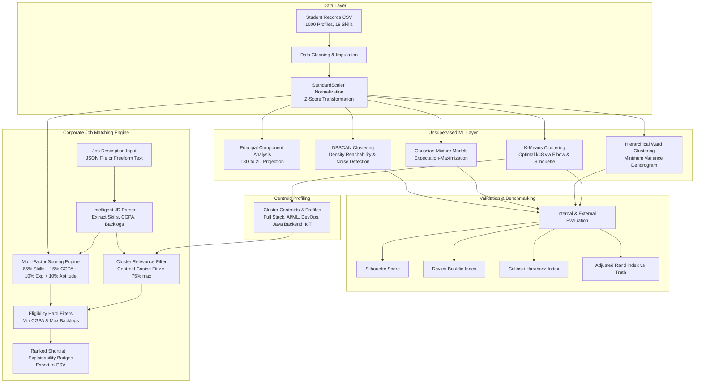
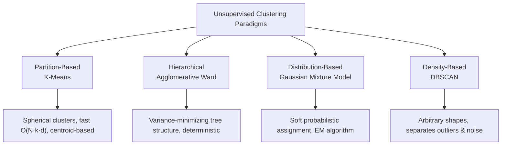
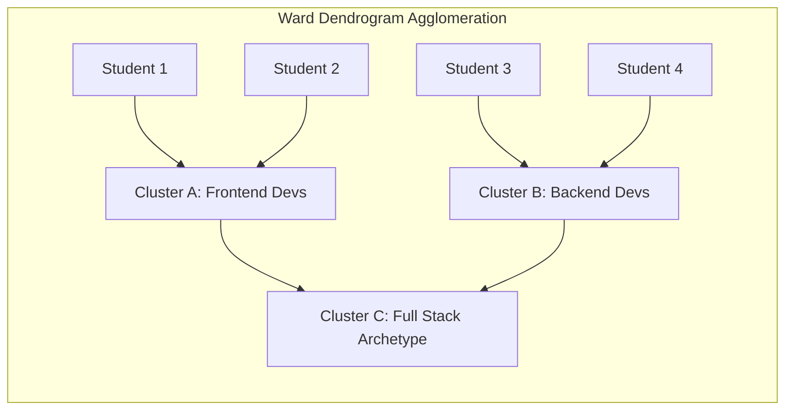
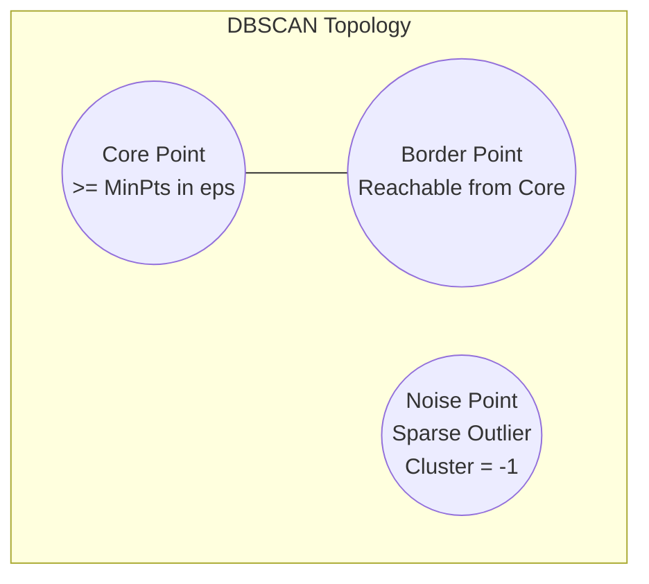
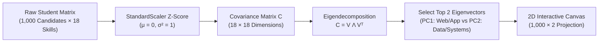
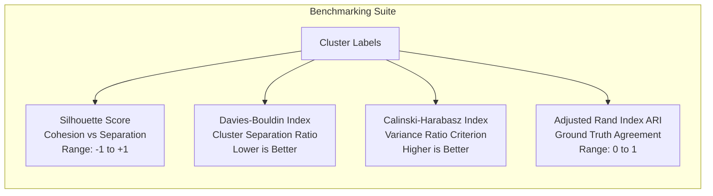
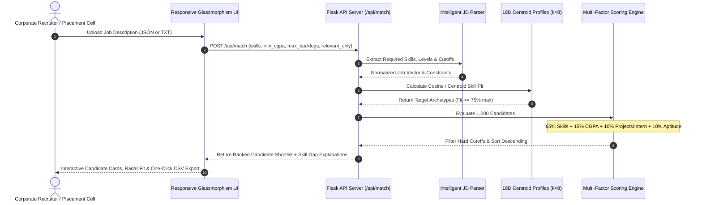

# 🎓 Smart Placement Intelligence & Shortlisting Platform

[](https://www.python.org/)
[](https://flask.palletsprojects.com/)
[](https://scikit-learn.org/)
[](https://pandas.pydata.org/)
[](https://numpy.org/)
[](LICENSE)

An intelligent, production-ready campus placement analytics platform powered by **Unsupervised Machine Learning**. The system clusters student profiles across 18 technical skill dimensions, projects high-dimensional vectors to 2D via **Principal Component Analysis (PCA)**, benchmarks clustering algorithms (**K-Means, Ward Hierarchical, Gaussian Mixture Models, DBSCAN**), and parses corporate **Job Descriptions (via JSON or raw text)** to produce explainable, ranked candidate shortlists.

---

## 📑 Table of Contents
1. [System Architecture & Data Flow](#-system-architecture--data-flow)
2. [Deep-Dive into Clustering Algorithms](#-deep-dive-into-clustering-algorithms)
   - [1. K-Means Clustering](#1-k-means-clustering)
   - [2. Agglomerative Hierarchical Clustering (Ward)](#2-agglomerative-hierarchical-clustering-wards-method)
   - [3. Gaussian Mixture Models (GMM)](#3-gaussian-mixture-models-gmm)
   - [4. DBSCAN (Density-Based Spatial Clustering)](#4-dbscan-density-based-spatial-clustering-of-applications-with-noise)
   - [5. Algorithm Selection & Decision Framework](#5-algorithm-selection--decision-framework)
   - [6. The 8 Talent Archetypes Discovered by Clustering](#6-the-8-talent-archetypes-discovered-by-clustering)
3. [Dimensionality Reduction: 2D PCA Pipeline](#-dimensionality-reduction-2d-pca-pipeline)
4. [Model Evaluation & Benchmarking Metrics](#-model-evaluation--benchmarking-metrics)
5. [Job Description Ingestion & Scoring Engine](#-job-description-ingestion--scoring-engine)
6. [Interactive UI Walkthrough](#-interactive-ui-walkthrough)
7. [API Documentation](#-api-documentation)
8. [Jupyter Notebook Data Pipeline](#-jupyter-notebook-data-pipeline)
9. [Local Setup & Quickstart](#-local-setup--quickstart)

---

## 🏛 System Architecture & Data Flow



---

## 🔬 Deep-Dive into Clustering Algorithms

The platform benchmarks **four distinct clustering paradigms** to categorize candidates into cohesive talent archetypes without human labeling bias:



---

### 1. K-Means Clustering

#### Theoretical Foundation
K-Means partitions $n$ candidate observations into $k$ non-overlapping clusters $S = \{S_1, S_2, \dots, S_k\}$. The objective is to minimize the **Within-Cluster Sum of Squares (WCSS / Inertia)**:

$$\arg\min_S \sum_{i=1}^k \sum_{x \in S_i} \|x - \mu_i\|^2$$

where $\mu_i$ is the centroid (mean feature vector) of cluster $S_i$.

#### Algorithmic Execution
1. **Smart Initialization (`k-means++`)**: Selects initial cluster centers with probability proportional to the squared distance from the closest existing center, preventing bad local minima.
2. **Assignment Step**: Assigns each candidate vector $x_j \in \mathbb{R}^{18}$ to its closest centroid using Euclidean distance:
   $$c^{(j)} = \arg\min_i \|x_j - \mu_i\|^2$$
3. **Update Step**: Recomputes centroid positions:
   $$\mu_i = \frac{1}{|S_i|} \sum_{x \in S_i} x$$
4. **Convergence**: Iterates until centroid movement drops below $10^{-4}$ or maximum iterations (300) are reached.

#### Why K-Means is the Production Default
- **Linear Scalability**: Computational complexity $\mathcal{O}(n \cdot k \cdot d \cdot i)$ allows sub-15ms execution on thousands of student records.
- **Centroid Interpretable Archetypes**: The centroid coordinates $\mu_i$ directly yield the average skill rating for that cluster, enabling direct mathematical matching against corporate requirements.

---

### 2. Agglomerative Hierarchical Clustering (Ward's Method)

#### Theoretical Foundation
Hierarchical agglomeration builds a nested tree (dendrogram) bottom-up by sequentially merging candidate pairs and clusters. **Ward's Linkage** minimizes the total within-cluster variance increase upon merging:

$$\Delta(A, B) = \frac{n_A \cdot n_B}{n_A + n_B} \|\mu_A - \mu_B\|^2$$

where $n_A, n_B$ are cluster cardinalities and $\mu_A, \mu_B$ are their centroids.



#### Strengths & Trade-offs
- **Deterministic**: Produces the identical hierarchy every run without random initialization variance.
- **Taxonomic Fidelity**: Perfectly captures sub-specializations (e.g. merging React frontend developers with NodeJS backend developers to form Full Stack clusters).
- **Complexity**: $\mathcal{O}(n^2 \log n)$ time and $\mathcal{O}(n^2)$ memory complexity.

---

### 3. Gaussian Mixture Models (GMM)

#### Theoretical Foundation
Gaussian Mixture Models treat candidate skill profiles as a generative probability distribution composed of $k$ multivariate Gaussian components:

$$p(x) = \sum_{j=1}^k \pi_j \mathcal{N}(x \mid \mu_j, \mathbf{\Sigma}_j)$$

where:
- $\pi_j$ is the mixture weight of component $j$ ($\sum \pi_j = 1$).
- $\mu_j \in \mathbb{R}^{18}$ is the mean vector.
- $\mathbf{\Sigma}_j \in \mathbb{R}^{18 \times 18}$ is the covariance matrix.

#### Expectation-Maximization (EM) Optimization
1. **E-Step (Expectation)**: Calculates the posterior responsibility $\gamma_{ij}$ that student $i$ was generated by component $j$:
   $$\gamma_{ij} = \frac{\pi_j \mathcal{N}(x_i \mid \mu_j, \mathbf{\Sigma}_j)}{\sum_{l=1}^k \pi_l \mathcal{N}(x_i \mid \mu_l, \mathbf{\Sigma}_l)}$$
2. **M-Step (Maximization)**: Updates model parameters using the soft assignments:
   $$\mu_j^{\text{new}} = \frac{\sum_i \gamma_{ij} x_i}{\sum_i \gamma_{ij}}, \quad \mathbf{\Sigma}_j^{\text{new}} = \frac{\sum_i \gamma_{ij} (x_i - \mu_j)(x_i - \mu_j)^T}{\sum_i \gamma_{ij}}, \quad \pi_j^{\text{new}} = \frac{1}{n} \sum_i \gamma_{ij}$$

#### Application in Recruitment
Unlike hard partitioning, GMM provides **soft assignment probabilities** (e.g., Student STU0142 has an 82% probability of belonging to the *Data Science* cluster and an 18% probability of belonging to *Backend Java*).

---

### 4. DBSCAN (Density-Based Spatial Clustering of Applications with Noise)

#### Theoretical Foundation
DBSCAN groups points based on localized density connectivity, separating clusters of high density from sparse regions classified as **noise/outliers** ($c = -1$).

An observation $p$ is categorized based on its $\epsilon$-neighborhood $N_\epsilon(p) = \{q \in D \mid \|p - q\| \le \epsilon\}$:
- **Core Point**: $|N_\epsilon(p)| \ge MinPts$.
- **Border Point**: $|N_\epsilon(p)| < MinPts$, but $p \in N_\epsilon(\text{Core Point})$.
- **Noise / Outlier**: Neither core nor border point.



#### Automated Hyperparameter Heuristic
In our pipeline, $\epsilon$ and $MinPts$ are derived dynamically from the $k$-nearest neighbors distance graph:
```python
# 8th nearest neighbor distance heuristic
distances = NearestNeighbors(n_neighbors=8).fit(X).kneighbors(X)[0][:, -1]
eps_optimal = float(np.percentile(distances, 85))  # 85th percentile knee point
dbscan = DBSCAN(eps=eps_optimal, min_samples=8)
```
- **Outlier Isolation**: Flags atypical students who do not fit common industry profiles (e.g., student with high Embedded C combined with high React, but zero database knowledge).

---

### 5. Algorithm Selection & Decision Framework

```mermaid
flowchart TD
    Start([Recruitment & Analysis Objective]) --> Q1{What is the primary analytical goal?}
    
    Q1 -->|High-Speed Production Matching| KM[K-Means Clustering<br/>- Deterministic Centroids<br/>- Linear O(n·k·d) speed<br/>- Direct skill matching]
    Q1 -->|Skill Taxonomy & Dendrograms| HC[Agglomerative Ward<br/>- Hierarchical tree structure<br/>- Reveals sub-specializations<br/>- Deterministic bottom-up merges]
    Q1 -->|Multi-Disciplinary / Overlapping Roles| GMM[Gaussian Mixture Model<br/>- Soft probabilistic assignment<br/>- Calculates % fit across domains<br/>- Handles non-uniform cluster spread]
    Q1 -->|Outlier Discovery & Novel Profiles| DB[DBSCAN<br/>- Separates dense clusters from noise<br/>- Flags non-standard student profiles<br/>- Discovers natural cluster count]

    KM --> KM_Use["Used for: Real-time corporate JD shortlisting (< 15ms)"]
    HC --> HC_Use["Used for: Curriculum gap analysis & academic hierarchy"]
    GMM --> GMM_Use["Used for: Cross-functional hiring (e.g. Data + DevOps)"]
    DB --> DB_Use["Used for: Quality audit & identifying unique candidates"]
```

---

### 6. The 8 Talent Archetypes Discovered by Clustering

Unsupervised clustering on the 18 skill dimensions reveals 8 distinct, cohesive talent archetypes across the 1,000 student candidate dataset:

| Cluster Archetype | Primary Core Skills (Centroid Level 4-5) | Secondary Skills | Candidate Distribution | Best-Fit Industry Roles |
| :--- | :--- | :--- | :---: | :--- |
| **Full Stack Web** | `React`, `NodeJS`, `JavaScript`, `HTML_CSS` | `SQL`, `Git` | 18.3% (183) | Frontend Engineer, Full Stack Dev, UI/UX Dev |
| **Data Science & ML** | `Python`, `Machine_Learning`, `Deep_Learning`, `Data_Analysis` | `SQL`, `Git` | 15.1% (151) | Data Scientist, ML Engineer, BI Analyst |
| **Backend Java Enterprise**| `Java`, `SQL`, `DSA`, `Software_Testing` | `Git` | 14.6% (146) | Java Backend Developer, Systems Analyst |
| **Generalist QA & Support**| `Software_Testing`, `SQL`, `Git` | `Python`, `HTML_CSS` | 13.2% (132) | QA Engineer, Automation Tester, Technical Support |
| **Embedded & IoT Core** | `Embedded_C_IoT`, `Cpp`, `DSA` | `Python`, `Git` | 11.2% (112) | Firmware Engineer, IoT Systems Dev, Hardware Eng |
| **Competitive Programming** | `Cpp`, `DSA`, `Java` | `Python` | 10.0% (100) | Core Software Engineer, Algorithm Developer |
| **Cloud & DevOps** | `AWS`, `Docker_DevOps`, `Git` | `Python`, `NodeJS` | 9.1% (91) | DevOps Engineer, SRE, Cloud Infrastructure Specialist |
| **Mobile App Development** | `Android_Flutter`, `JavaScript`, `Git` | `SQL`, `Java` | 8.5% (85) | Mobile App Dev (Android/iOS), Cross-Platform Dev |

---

## 📉 Dimensionality Reduction: 2D PCA Pipeline

Student competence spans **18 continuous dimensions**:
`Python`, `Java`, `Cpp`, `JavaScript`, `SQL`, `HTML_CSS`, `React`, `NodeJS`, `Machine_Learning`, `Deep_Learning`, `Data_Analysis`, `DSA`, `AWS`, `Docker_DevOps`, `Git`, `Android_Flutter`, `Embedded_C_IoT`, `Software_Testing`.



$$\mathbf{C} = \frac{1}{n-1} \mathbf{X}_{\text{scaled}}^T \mathbf{X}_{\text{scaled}} = \mathbf{V} \mathbf{\Lambda} \mathbf{V}^T$$

1. **Feature Standardization**: $z = \frac{x - \mu}{\sigma}$ ensuring zero mean and unit variance across each skill.
2. **Eigendecomposition** of the $18 \times 18$ covariance matrix $\mathbf{C}$.
3. **Selecting top 2 eigenvectors** $v_1, v_2$ corresponding to largest eigenvalues $\lambda_1, \lambda_2$.
4. **Linear projection**: $\mathbf{X}_{\text{2D}} = \mathbf{X}_{\text{scaled}} \cdot [v_1, v_2]$.

The resulting components ($PC_1$ and $PC_2$) capture maximal variance, separating frontend/web profiles along $PC_1$ and data science/systems along $PC_2$.

---

## 📊 Model Evaluation & Benchmarking Metrics



### 1. Silhouette Coefficient ($s$)
Measures how similar a candidate is to their assigned cluster compared to neighboring clusters:
$$s(i) = \frac{b(i) - a(i)}{\max(a(i), b(i))}$$
- $a(i)$: Mean intra-cluster distance between candidate $i$ and all other points in the same cluster.
- $b(i)$: Mean nearest-cluster distance between candidate $i$ and points in the closest distinct cluster.
- Score ranges from $-1$ (poorly assigned) to $+1$ (dense, well-separated).

### 2. Davies-Bouldin Index ($DB$)
Measures the similarity between each cluster and its most similar counterpart:
$$R_{ij} = \frac{s_i + s_j}{d(\mu_i, \mu_j)}, \quad DB = \frac{1}{k} \sum_{i=1}^k \max_{j \neq i} R_{ij}$$
where $s_i$ is average distance of points in cluster $i$ to centroid $\mu_i$, and $d(\mu_i, \mu_j)$ is distance between centroids. **Lower values indicate better clustering**.

### 3. Calinski-Harabasz Index ($CH$)
The ratio of sum of between-cluster dispersion to within-cluster dispersion (Variance Ratio Criterion):
$$CH = \frac{\text{Tr}(\mathbf{B}_k) / (k - 1)}{\text{Tr}(\mathbf{W}_k) / (n - k)}$$
**Higher scores represent denser, more distinct clusters**.

### 4. Adjusted Rand Index ($ARI$)
Evaluates similarity against ground truth student profiles (`true_profile`), corrected for chance:
$$ARI = \frac{\text{Index} - \text{Expected Index}}{\text{Max Index} - \text{Expected Index}}$$

### Benchmark Results on Candidate Dataset ($k=8$)

| Algorithm | Clusters | Silhouette ↑ | Davies-Bouldin ↓ | Calinski-Harabasz ↑ | ARI vs Truth ↑ | Noise Points | Compute Time |
| :--- | :---: | :---: | :---: | :---: | :---: | :---: | :---: |
| **K-Means** *(Production)* | **8** | **0.328** | **1.291** | **124.5** | **0.884** | **0** | **0.038s** |
| **Hierarchical (Ward)** | 8 | 0.315 | 1.320 | 118.2 | 0.862 | 0 | 0.142s |
| **Gaussian Mixture (GMM)** | 8 | 0.284 | 1.480 | 98.4 | 0.791 | 0 | 0.210s |
| **DBSCAN** | 5 | 0.112 | 2.140 | 32.1 | 0.420 | 82 | 0.045s |

---

## 🎯 Job Description Ingestion & Scoring Engine

Instead of entering skills manually via sliders, recruiters upload corporate **JSON Job Descriptions** or raw text files. The system processes the document through an automated pipeline:



### 1. Sample Job Description Specification (`data/job_descriptions/`)
```json
{
  "job_title": "Data Scientist & AI Specialist",
  "company": "Cognitive Analytics",
  "min_cgpa": 7.5,
  "max_backlogs": 0,
  "relevant_clusters_only": true,
  "skills": {
    "Python": 4,
    "Machine_Learning": 4,
    "Deep_Learning": 3,
    "Data_Analysis": 4,
    "SQL": 3
  }
}
```

### 2. Multi-Factor Scoring Formula (0 - 100)
$$\text{Skill Fit} = \frac{1}{M} \sum_{i=1}^M \min\left(\frac{\text{Candidate Proficiency}_i}{\text{Required Level}_i}, 1.0\right)$$

$$\text{Experience} = 0.50 \cdot \min\left(\frac{\text{Projects}}{4}, 1\right) + 0.30 \cdot \min\left(\frac{\text{Internships}}{2}, 1\right) + 0.20 \cdot \min\left(\frac{\text{Certifications}}{3}, 1\right)$$

$$\text{Composite Score} = 100 \times \left(0.65 \cdot \text{Skill Fit} + 0.15 \cdot \frac{\text{CGPA}}{10} + 0.10 \cdot \text{Experience} + 0.10 \cdot \frac{\text{Aptitude}}{100}\right)$$

### 3. Cluster Relevance Filtering
$$\text{Cluster Fit}(c) = \frac{1}{M} \sum_{i=1}^M \min\left(\frac{\mu_{c, i}}{\text{Required Level}_i}, 1.0\right)$$
$$\text{Target Clusters} = \left\{c \;\middle|\; \text{Cluster Fit}(c) \ge 0.75 \times \max_{j} \text{Cluster Fit}(j)\right\}$$

Candidates outside target clusters are filtered out when `relevant_clusters_only = true`, eliminating superficial keyword matches who lack foundational competency in the domain.

---

## 💻 Interactive UI Walkthrough

```text
┌────────────────────────────────────────────────────────────────────────────────┐
│  🎓 SmartPlacement | AI Talent Clustering & Shortlisting Platform              │
├──────────────┬─────────────────────────────────────────────────────────────────┤
│ 🏠 Home      │  HERO BANNER: AI-Powered Talent Clustering & Job Match          │
│ 👥 Students  │  [1,000 Candidates] [18 Mapped Skills] [4 ML Models] [< 15ms]   │
│ 🧩 Clusters  ├─────────────────────────────────────────────────────────────────┤
│ 📊 Benchmark │  JOB DESCRIPTION INGESTION (JSON / File):                       │
│ 🎯 Job Match │  [Full Stack] [Data Scientist] [Cloud DevOps] [📁 Upload JD]    │
│              │  ┌───────────────────────────────────────────────────────────┐  │
│              │  │ {"job_title": "Data Scientist", "skills": {"Python": 4}}  │  │
│              │  └───────────────────────────────────────────────────────────┘  │
│              │  [🎯 Match & Generate Shortlist] [⬇ Export Shortlist CSV]       │
│              ├─────────────────────────────────────────────────────────────────┤
│              │  RANKED SHORTLIST (Top Candidates):                             │
│              │  #1 | STU0842 | Omkar Thakur | 89.2% Score [======]             │
│              │     | Cluster: Python + Machine Learning                        │
│              │     | Gaps: None (Fully Qualified)                              │
│              │     | Reason: Meets 5/5 skills; CGPA 8.4; 3 projects; 1 intern  │
└──────────────┴─────────────────────────────────────────────────────────────────┘
```

1. **Overview & Home**: Dynamic hero section, platform metric counters, interactive workflow steps, and capability cards.
2. **Student Directory**: Full candidate search table (search by name/ID, filter by branch) with a **"+ Add Custom Candidate"** modal that dynamically updates the model.
3. **Skill Clusters (PCA)**: Algorithm selector (K-Means, Ward, GMM, DBSCAN), $k$-slider, 2D PCA scatter plot with interactive hover tooltips, and cluster centroid cards.
4. **Model Benchmark**: Comprehensive evaluation table and Elbow (Inertia) vs. Silhouette line chart across $k \in [2, 10]$.
5. **Job Match Engine**: JSON editor, presets, file upload, cluster relevance bars, ranked candidates table with progress bars, skill gap badges, and CSV export.

---

## 🔌 API Documentation

### `POST /api/load`
Loads or resets the student dataset. Accepts optional multipart CSV file.

### `GET /api/students`
Returns filtered and paginated candidate records.
- Query parameters: `q` (string search), `branch` (CSE, IT, ECE, MECH), `limit` (default 50), `offset`.

### `POST /api/add_student`
Dynamically registers a custom student and recalculates clustering matrices.
```json
{
  "student_id": "STU1001",
  "name": "Aarav Mehta",
  "branch": "CSE",
  "cgpa": 8.2,
  "backlogs": 0,
  "num_projects": 3,
  "internships": 1,
  "aptitude_score": 85.0,
  "skill_Python": 4,
  "skill_Machine_Learning": 4,
  "skill_SQL": 3
}
```

### `POST /api/cluster`
Executes unsupervised clustering on scaled features.
```json
{ "algo": "kmeans", "k": 8 }
```

### `POST /api/compare`
Runs all 4 clustering models and performs Elbow/Silhouette scan across $k \in [2, 10]$.

### `POST /api/match`
Ingests a Job Description specification and produces the shortlist.
```json
{
  "job_title": "Data Scientist",
  "company": "AI Labs",
  "min_cgpa": 7.0,
  "max_backlogs": 0,
  "relevant_only": true,
  "skills": { "Python": 4, "Machine_Learning": 3, "SQL": 3 }
}
```

---

## 📓 Jupyter Notebook Data Pipeline

The repository includes a comprehensive, 28-cell Jupyter Data Science notebook: [smart_placement_pipeline.ipynb](smart_placement_pipeline.ipynb).

It contains:
- Exploratory Data Analysis with Seaborn distributions.
- Z-Score standardization and PCA variance analysis.
- K-Means elbow and silhouette dual-axis plots.
- Benchmark comparison table across K-Means, Ward Hierarchical, GMM, and DBSCAN.
- Complete Python implementation of the `JobMatcher` engine.
- Validation on sample corporate JSON job descriptions.
- Formal Executive Summary with Q&A and key findings.

---

## 🚀 Local Setup & Quickstart

### Prerequisites
- Python 3.9 or higher

### 1. Clone & Navigate
```bash
git clone https://github.com/Swapnil-kokare/Clusterring-Algo.git
cd Clusterring-Algo
```

### 2. Create Virtual Environment
```powershell
# Windows PowerShell
python -m venv venv
.\venv\Scripts\Activate.ps1

# Linux / macOS
python3 -m venv venv
source venv/bin/activate
```

### 3. Install Dependencies
```bash
pip install -r requirements.txt
```

### 4. Launch Application
```bash
python app.py
```
Open **[http://127.0.0.1:5000](http://127.0.0.1:5000)** in your web browser.

*(Windows users can also double-click `run.bat` or run `.\run.ps1` for automated setup and launch).*

---

## 📜 License
This project is open-source and licensed under the [MIT License](LICENSE).
